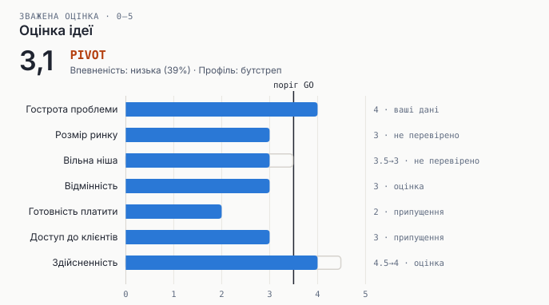

# SDD Product: продуктовий оркестратор для Claude Code

*Tell it an idea, get a verdict that only verified evidence can move.*

Ви пишете `/sdd-product:product <ідея>`. Оркестратор вибирає маршрут, ставить лише ті питання, на які може відповісти тільки засновник, і шукає конкурентів і ринок в інтернеті. Далі він проганяє фреймворки з окремо встановленого [pm-skills](https://github.com/phuryn/pm-skills) і дає вердикт GO, PIVOT або KILL із графіками. Вердикт не можна підняти словами: кожне джерело скрипт відкриває сам, а оцінки обрізаються тим, наскільки їх підтверджують докази.

Плагін незалежний. Якщо встановлено `sdd-kit` з маркетплейсу SDD Kit, після вердикту GO оркестратор передає першу фічу MVP у `/sdd-kit:sdd`.

З терміналу те саме: `claude plugin marketplace add HomeProgrammer1/product-manager-plugin`, потім `claude plugin install sdd-product@product-manager-plugin`.

## Що всередині

| Частина | Що робить |
|---|---|
| `/sdd-product:product` | Оркестратор. Має 7 маршрутів (`validate`, `competition`, `market`, `business`, `strategy`, `launch`, `build`), глибину `quick`, `standard` або `deep` і профіль засновника `side`, `bootstrapped` або `venture` |
| агент `market-researcher` | Веб-дослідник на Sonnet. Для кожного факту повертає URL і точну цитату |
| агент `skeptic` | Незалежний red team на Opus. Бачить лише файли, без розмови, яка їх породила. Пропонує знизити оцінки, які не тримаються на доказах |
| `/sdd-product:product-charts` | `verify` відкриває джерела і шукає цитати, `check` перевіряє дані, `build` малює 8 графіків і дашборд. Чистий Python |

## Встановлення

```text
/plugin marketplace add phuryn/pm-skills
/plugin install pm-product-discovery@pm-skills
/plugin install pm-product-strategy@pm-skills
/plugin install pm-market-research@pm-skills
/plugin install pm-go-to-market@pm-skills
/plugin install pm-marketing-growth@pm-skills
/plugin install pm-execution@pm-skills

/plugin marketplace add HomeProgrammer1/product-manager-plugin
/plugin install sdd-product@product-manager-plugin
```

Без pm-skills оркестратор теж працює, але кожен крок без потрібного скіла позначається `(without pm-skills)` і потрапляє в розділ «Прогалини».

## Як користуватись

```text
/sdd-product:product Telegram-бот для запису до майстрів манікюру в Польщі, $9 на місяць --profile bootstrapped
/sdd-product:product Хто конкуренти сервісів запису в Польщі? --depth quick
/sdd-product:product --resume salon-booking --evidence ~/notes/interviews.md
```

Оркестратор запускається лише явною командою. Тому він не конкурує з іншими скілами валідації ідей, які спрацьовують на звичайну фразу.

## Чесність вердикту

| Що | Як це забезпечено |
|---|---|
| Джерело справжнє | `verify` відкриває сторінку і шукає точну цитату. Регістр, лапки, пробіли й роздільники тисяч не важать. Біля збігу зберігається ~250 символів контексту, щоб людина могла перевірити |
| Запис перевірки не можна підробити | Запис підписаний ключем машини з `~/.config/sdd-product/verify.key`, що лежить поза проєктом. Якщо після перевірки змінити URL, цитату або файл, підпис перестає збігатися |
| Оцінка не вища, ніж дозволяють докази | `tested` і `verified` дозволяють до 5. Сторінка без цитати і `estimated` дозволяють до 4. `unverified` і `assumed` дозволяють до 3 |
| `tested` означає ваші дані | Лише файл, який ви дали (`--evidence`), з цитатою з нього. Оркестратор у `evidence/` не пише |
| Модель не погоджується сама з собою | Питання pm-skills про ваші факти модель не закриває сама: вони йдуть у розділ «Питання, на які відповісте лише ви». Скептик працює в окремому контексті, і його заперечення діє, поки його не спростує перевірене джерело |
| Пороги під мету | Профіль задає поріг GO: 3,3 для підробітку, 3,5 для бутстрепу, 3,8 для венчуру. Вага розміру ринку буває 0,5, 1 або 2. Ваги стандартних вимірів фіксовані, і змінити їх у JSON не можна |
| Хибна точність | Якщо зміна одного виміру на ±0,5 перевертає вердикт, він позначається як **крихкий** |

Атаку з розбору (джерело «мені так здається» плюс 0,5 до кожної оцінки) тепер відбиває `check`: оцінка з таким джерелом дає помилку. А вердикт і без цього лишається PIVOT, бо неперевірене джерело дозволяє оцінку не вище 3. Це перевіряє тест `test_original_attack_title_only_source`.

## Вартість

| Глибина | Агенти | Пошуки |
|---|---|---|
| quick | лише скептик | до 3 у головній сесії |
| standard | 2 дослідники і скептик | до 6 пошуків і 10 сторінок на дослідника |
| deep | 3 дослідники і скептик | до 8 пошуків і 14 сторінок на дослідника |

Скіли pm-skills отримують готові докази з інструкцією «не шукай в інтернеті і не зберігай файли». Так за той самий пошук не доводиться платити двічі, а файли не з'являються поза `product/`. Реальну вартість прогону ще не міряли.

## Графіки



| Графік | На яке питання відповідає |
|---|---|
| market | Наскільки великий ринок і яку частку реально взяти (TAM/SAM/SOM) |
| trend | Ринок росте чи падає |
| pricing | Де ваша ціна відносно тих, що вже платять |
| features | Де ви на рівні з конкурентами, де краще, а чого бракує |
| positioning | Чи є вільне місце на карті 2×2 |
| assumptions | Що може вбити ідею і що перевіряти першим |
| scorecard | Вердикт. Смуга показує зараховану оцінку, контур показує заявлену, підпис виглядає як `заявлено→зараховано · доказ` |
| experiments | Що робити найближчими тижнями і що вважати успіхом |

Стиль той самий, що в `sdd-diagrams`, підтримується `--tokens`. Є темна тема, підказки на кожній позначці й таблиця даних під кожним графіком. Приклад лежить у [docs/example/index.html](docs/example/index.html). Дані в ньому ілюстративні: URL конкурентів вигадані, тому вони «не перевірено», а файл інтерв'ю перевірено.

## Сумісність

- Хуків немає, і запускається лише явною командою.
- Скіли pm-skills викликаються за назвою. На старті оркестратор звіряє потрібні назви з тим, що встановлено, тож перейменування в pm-skills видно одразу, а не тихо.
- Пише лише в `product/`. Після прогону він перевіряє, чи хтось не записав файли деінде, і каже, якщо записав.

## Перевірки

```bash
PM_SKILLS_DIR=/path/to/pm-skills python3 -m unittest discover -s tests
```

33 тести покривають:
- `verify`: збіг цитат, мертві й вигадані джерела, правки після перевірки, підроблений підпис, справжній HTTP через локальний сервер;
- обрізання оцінок, профілі, фіксовані ваги, крихкість, заперечення скептика;
- оригінальну атаку з розбору;
- графіки, контраст, токени;
- те, що оркестратор запускається лише явно і що скептик не може писати файли;
- те, що кожна назва pm-skills у playbook існує у версії 2.2.0.

`claude plugin validate` проходить.

## Чого це не вирішує

- **Повний живий прогін ще не робився.** Середовище, де це збиралося, не дає запускати окремий Claude з вебом і записом файлів.
- `verify` не відкриває сторінки, що рендеряться JavaScript, і сторінки за пейволом. Такі джерела отримують статус «сторінка є, цитати нема» і дозволяють оцінку до 4.
- Цитата може бути справжньою, а висновок з неї хибним. Це ловить лише скептик або людина, і скрипт тут не допоможе.
- Модель, яка має доступ до терміналу, технічно може прочитати ключ і підробити підпис. Захист розрахований на неуважність, а не на зловмисника.
- Ринок інструментів валідації ідей переповнений. Плагін цього не змінює.

## Ліцензія

MIT. pm-skills (MIT, © Paweł Huryn) встановлюється окремо, плагін лише викликає його скіли за назвою.
